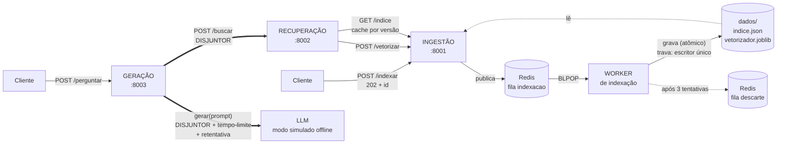
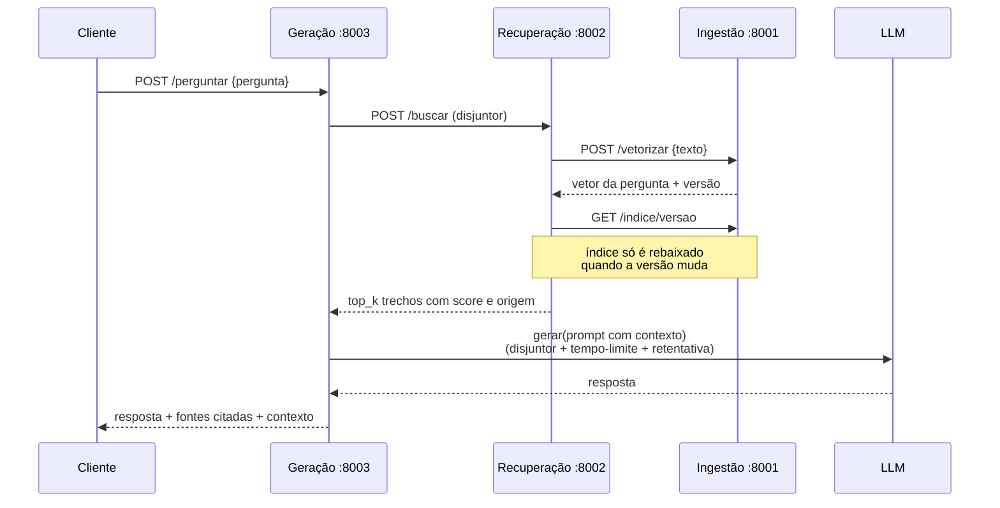

# C2.A2 — RAG Distribuído em Microsserviços

**Sistemas Distribuídos e Computação em Nuvem · FAESA · 2026/2**
Prof. M.Sc. Howard Cruz Roatti · Aluno: Jordhan ([@jordhanF](https://github.com/jordhanF))

[](https://github.com/jordhanF/sd-2026-2-kit-c2a2/actions/workflows/testes.yml)

Um sistema de perguntas e respostas sobre documentos próprios (RAG), decomposto em
**três serviços independentes** mais um **worker de fila**, com a dependência externa
lenta e instável — a API do LLM — protegida por **disjuntor, tempo-limite e retentativa**.

A IA aqui é carga de trabalho, não objeto de estudo: o vetorizador é o TF-IDF do kit e o
cliente de LLM tem modo simulado. O que este repositório tenta fazer bem é a **engenharia
distribuída** em volta disso.

---

## A arquitetura



### As quatro peças

| Processo | Responsabilidade | Porta |
|---|---|---|
| **Ingestão** (`servicos/ingestao/`) | dono do índice e do espaço vetorial: aceita documentos, publica na fila, serve o índice | 8001 |
| **Worker** (`servicos/worker/`) | reajusta o vocabulário, revetoriza o corpus e persiste — fora do caminho da requisição | — |
| **Recuperação** (`servicos/recuperacao/`) | compara a pergunta com o índice e devolve os `top_k` trechos | 8002 |
| **Geração** (`servicos/geracao/`) | monta o prompt, chama o LLM e cita as fontes | 8003 |

Cada um sobe como processo próprio, com seu próprio ciclo de vida, e conversa com os
outros **só por HTTP** — ou pela fila. Nenhum importa o módulo do outro.

### O fluxo da pergunta



### O fluxo da indexação (mensageria)

```
POST /indexar  ─→  202 Accepted {"id": "d5f1ec99d4b3"}      (não espera indexar)
                        │
                        ├─→ fila 'indexacao' ─→ worker ─→ dados/indice.json
                        │                          │
GET /tarefa/<id> ───────┘                          └─→ 3 falhas ─→ fila 'descarte'

estados: na_fila → processando → pronto      |      retentando → erro
```

---

## Por que a mensageria entra na indexação

O TF-IDF tem **vocabulário global**. Indexar um documento novo muda o vocabulário e, com
ele, o espaço vetorial: todos os vetores anteriores deixam de ser comparáveis. A única
saída correta é **revetorizar o corpus inteiro** a cada lote.

Medido neste repositório (`servicos.comum.indexador.reindexar`):

| Documentos no índice | Reindexação completa |
|---|---|
| 3 | 0,00 s |
| 50 | 0,01 s |
| 200 | 0,06 s |
| 800 | 0,30 s |

O número que importa não é o total: é que **indexar UM documento num índice de 800 custa
os mesmos 0,30 s** — o custo de um pedido cresce com o tamanho do índice, não com o do
pedido. Num índice de dezenas de milhares de documentos isso vira segundos dentro de um
`POST`, segurando a conexão do cliente por um trabalho que não é dele. Por isso a
ingestão responde **202 Accepted** e o worker faz o trabalho.

## Por que a recuperação não vetoriza sozinha

A recuperação poderia reconstruir o `TfidfVectorizer` a partir dos textos que recebe. Não
reconstrói: ela pede o vetor da pergunta a **quem é dono do espaço vetorial** (`POST
/vetorizar` na ingestão).

Duas cópias do vocabulário seriam duas fontes de verdade. No dia em que divergissem — uma
indexação no meio da pergunta, uma versão diferente da biblioteca em cada container — a
comparação daria errado **sem erro nenhum**: vetores de espaços diferentes produzem
similaridades plausíveis e sem sentido. Falha silenciosa é pior que falha ruidosa.

---

## Como executar do zero

Pré-requisitos: **Python 3.11+**, **Docker** e **Docker Compose**.

### Opção A — tudo em container (um comando)

```bash
git clone https://github.com/jordhanF/sd-2026-2-kit-c2a2.git
cd sd-2026-2-kit-c2a2
cp .env.example .env

docker compose up -d --build        # redis + ingestao + worker + recuperacao + geracao
docker compose ps                   # os cinco de pé

# indexa a base de teste e faz três perguntas de ponta a ponta
pip install requests
python exemplos/fluxo_completo.py
```

> Se a porta 6379 já estiver em uso na sua máquina:
> `PORTA_REDIS=6381 docker compose up -d --build`. O Redis só é publicado no host para
> inspeção — os serviços falam com ele pela rede interna do compose.

### Opção B — processos locais (como nas aulas)

```bash
git clone https://github.com/jordhanF/sd-2026-2-kit-c2a2.git
cd sd-2026-2-kit-c2a2

python -m venv .venv
source .venv/bin/activate          # Windows: .venv\Scripts\activate
pip install -r requirements.txt
cp .env.example .env

docker compose up -d redis         # só o Redis da fila
```

Agora os quatro processos, **cada um no seu terminal** (com o `.venv` ativo):

```bash
# terminal 1 — ingestão
uvicorn servicos.ingestao.app:app --port 8001

# terminal 2 — worker de indexação
python -m servicos.worker.indexador

# terminal 3 — recuperação
uvicorn servicos.recuperacao.app:app --port 8002

# terminal 4 — geração
uvicorn servicos.geracao.app:app --port 8003
```

Documentação interativa (OpenAPI) de cada serviço: `/docs` — por exemplo
<http://127.0.0.1:8003/docs>.

### Indexar e perguntar

```bash
python exemplos/indexar_documentos.py          # carrega documentos/*.txt pela fila
python exemplos/perguntar.py "o que diz o teorema CAP?"
```

Ou direto no `curl`:

```bash
curl -X POST http://127.0.0.1:8001/indexar -H "Content-Type: application/json" \
  -d '[{"texto":"O teorema CAP trata de consistencia e disponibilidade.","origem":"aula11"}]'
# HTTP 202 {"id":"...","status":"na_fila","documentos":1,"consulte":"/tarefa/..."}

curl http://127.0.0.1:8001/tarefa/<ID>         # na_fila → processando → pronto

curl -X POST http://127.0.0.1:8003/perguntar -H "Content-Type: application/json" \
  -d '{"pergunta":"o que diz o teorema CAP?"}'
```

> **Use `127.0.0.1`, não `localhost`.** No Windows, `localhost` resolve primeiro para IPv6
> e cada requisição paga ~2 s esperando o IPv4: medidos **2,068 s** com `localhost` contra
> **0,007 s** com `127.0.0.1`, no mesmo endpoint. É por isso que os padrões do projeto
> usam o endereço numérico.

---

## Como testar

### A suíte automatizada

```bash
pip install -r requirements-dev.txt
python -m pytest testes -q
# 47 passed
```

Roda offline, sem servidor e sem Redis de pé (a fila é exercitada com um duplo em
`testes/duplos.py`). Cobre busca e reranking, persistência, fila com retentativa e
descarte, classificação de falhas transitórias e os dois disjuntores.

### O checklist do kit, item por item

**1. Desligue a internet: o modo simulado mantém o sistema de pé?**

```bash
python exemplos/fluxo_completo.py
```

Sem `LLM_API_KEY`, `servicos/comum/llm.py` entra em modo simulado e monta a resposta a
partir do contexto recuperado. Nenhuma chamada sai da máquina — a verificação acima roda
com a rede desligada.

**2. Derrube o serviço de recuperação: o disjuntor abre como esperado?**

Pare o terminal 3 (`Ctrl+C`) ou `docker compose stop recuperacao`, e rode:

```bash
python exemplos/roteiro_disjuntor.py
```

Saída real deste repositório:

```
antes:  recuperacao=fechado(0 falhas) llm=fechado(0 falhas)

1. HTTP 503 motivo=recuperacao_indisponivel        em 2.04s
2. HTTP 503 motivo=recuperacao_indisponivel        em 2.04s
3. HTTP 503 motivo=recuperacao_indisponivel        em 2.05s   → circuito ABRE
4. HTTP 503 motivo=disjuntor_recuperacao_aberto    em 0.01s
5. HTTP 503 motivo=disjuntor_recuperacao_aberto    em 0.01s
```

É o ponto todo do disjuntor: as três primeiras falhas **pagam** o custo da conexão
recusada (2,04 s cada); a partir da quarta a recusa é imediata — **200× mais rápida** — e
o `motivo` muda. Suba a recuperação de novo, espere a janela de 20 s e pergunte: o
circuito vai para `meio`, deixa passar **uma** chamada de teste e fecha.

```bash
curl http://127.0.0.1:8003/saude
# {"disjuntores":{"recuperacao":{"estado":"fechado","falhas":0},"llm":{...}}}
```

Em container os tempos são outros e a conclusão é a mesma: 7,32 s por falha com o circuito
fechado, 0,02 s depois que ele abre.

**3. A chave da API está FORA do código?**

Sim. `servicos/comum/llm.py` lê `LLM_API_KEY` do ambiente, o `.env` está no `.gitignore` e
o `docker-compose.yml` repassa a variável sem valor embutido. Sem chave, modo simulado.

```bash
grep -rn "sk-" --include=*.py --include=*.yml .    # nada
```

### Retentativa e fila de descarte

Suba o worker com o gatilho de falha e mande um documento que o dispare:

```bash
SIMULAR_FALHA_EM=explode python -m servicos.worker.indexador

curl -X POST http://127.0.0.1:8001/indexar -H "Content-Type: application/json" \
  -d '[{"texto":"isso vai explode aqui","origem":"teste_falha"}]'
```

Log real do worker:

```
tarefa d7ea6f166961 recebida (1 documento(s), tentativa 1)
tarefa d7ea6f166961 falhou (falha simulada); 2a tentativa em 1.0s
tarefa d7ea6f166961 recebida (1 documento(s), tentativa 2)
tarefa d7ea6f166961 falhou (falha simulada); 3a tentativa em 2.0s
tarefa d7ea6f166961 recebida (1 documento(s), tentativa 3)
tarefa d7ea6f166961 descartada apos 3 tentativas: falha simulada
```

E a tarefa tem **estado terminal**, não fica em limbo:

```bash
curl http://127.0.0.1:8001/tarefa/d7ea6f166961
# {"status":"erro","tentativas":3,"erro":"falha simulada (gatilho 'explode')"}
docker exec sd-2026-2-kit-c2a2-redis-1 redis-cli LRANGE descarte 0 -1
```

### Persistência (o índice sobrevive ao reinício)

```bash
curl http://127.0.0.1:8001/saude      # documentos: 3, versao: 0a8a856fc27b
# reinicie a ingestão e o worker
curl http://127.0.0.1:8001/saude      # documentos: 3, MESMA versao
```

---

## Medições

Máquina: Windows 11, Python 3.11, Redis em container, tudo em `127.0.0.1`. As linhas
"em container" vêm do stack completo em `docker compose`.

| Medida | Valor |
|---|---|
| Indexação de 3 documentos (fila → worker → disco) | 0,02 s |
| `POST /perguntar` — 1ª chamada | 0,102 s |
| `POST /perguntar` — média das 4 seguintes | 0,055 s |
| `POST /perguntar` — mais rápida | 0,037 s |
| Falha com o circuito **fechado**, processos locais (conexão recusada) | 2,04 s |
| Falha com o circuito **aberto**, processos locais (recusa imediata) | 0,01 s |
| Falha com o circuito **fechado**, em container (nome do serviço sem resolver) | 7,32 s |
| Falha com o circuito **aberto**, em container | 0,02 s |
| Índice em disco (3 documentos) | 5,5 KB + 4,2 KB do vetorizador |

Cada `/perguntar` são quatro saltos de rede (geração → recuperação → ingestão duas vezes)
e ainda fica em dezenas de milissegundos, porque o índice vem do cache enquanto a versão
não muda. A linha que interessa é a do disjuntor: **2,04 s contra 0,01 s** é a diferença entre uma
falha que se propaga pelo sistema e uma falha que morre na porta. Em container a diferença
é maior ainda — **7,32 s contra 0,02 s** — porque ali a falha não é "conexão recusada", é o
nome do serviço parado deixando de resolver, o que custa bem mais caro. Quanto pior a
dependência, mais o disjuntor paga por si.

Exemplo de resposta (modo simulado, com as fontes citadas):

```
PERGUNTA: o que diz o teorema CAP?

RESPOSTA:
[MODO SIMULADO - sem LLM_API_KEY configurada]
Com base nos documentos recuperados: O teorema CAP afirma que, diante de uma particao
de rede, um sistema distribuido precisa escolher entre consistencia e disponibilidade...

FONTES:
  - teorema_cap.txt (relevancia 0.4136)
  - sistemas_distribuidos.txt (relevancia 0.1040)

indice versao 0a8a856fc27b | modelo gpt-4o-mini
```

---

## Decisões de projeto

**Dois disjuntores, não um.** `disjuntor_recuperacao` cobre a chamada HTTP à recuperação e
`disjuntor_llm` cobre a chamada ao LLM. Com um só, o LLM fora do ar cegaria também a
recuperação — falhas diferentes precisam de contadores diferentes. E só com o par é
possível atender o checklist do kit, que manda derrubar a *recuperação* e ver o circuito
abrir. `GET /saude` expõe os dois estados.

**Disjuntor, tempo-limite e retentativa tratam falhas diferentes** (item 4 do edital). O
tempo-limite corta a chamada travada; a retentativa (`servicos/comum/retentativa.py`)
cuida do que é transitório — timeout, 429, 5xx — com espera progressiva; o disjuntor cuida
do que é persistente, recusando sem tentar. Erro permanente (401 de chave inválida, 400 de
pedido malformado) **não é retentado**: repetir o mesmo pedido errado só gasta tempo e
quota.

**A retentativa fica POR DENTRO do disjuntor.** `disjuntor_llm.chamar(com_retentativa,
gerar, ...)`: uma sequência esgotada de tentativas conta como **uma** falha. Se cada
tentativa contasse, o circuito abriria no primeiro soluço de rede.

**202 Accepted, não 200.** O `POST /indexar` não devolve o índice: devolve um comprovante.
O cliente acompanha em `GET /tarefa/{id}` e não fica preso a um trabalho cujo custo cresce
com o tamanho do índice.

**Falha tem estado terminal.** Ao esgotar as tentativas, o worker grava `status: erro` no
status da tarefa e a joga na fila `descarte`. Sem isso o cliente consultaria
`/tarefa/{id}` para sempre sem nunca descobrir que a tarefa morreu.

**Mecanismo na fila, política no worker.** `servicos/comum/fila.py` sabe *como* publicar,
devolver e descartar; `servicos/worker/indexador.py` decide *quantas* vezes tentar e
*quanto* esperar. Trocar a política não mexe no transporte.

**Escritor único do índice.** Reindexar é escrita no índice **inteiro**, porque o
vocabulário muda. Dois workers reindexando ao mesmo tempo se sobrescreveriam e um dos
lotes desapareceria sem erro, então o worker toma uma trava no Redis (`SET NX PX`) antes
de gravar. O TTL garante que um worker morto não tranque a fila para sempre. Com isso o
worker pode ser replicado (`docker compose up -d --scale worker=3`) sem corromper o
índice — quem não consegue a trava devolve a tarefa à fila **sem gastar tentativa**, porque
estar ocupado não é culpa da tarefa.

**Gravação atômica.** Índice e vetorizador vão para arquivo temporário e entram por
`os.replace()`. Um worker morto no meio da escrita não deixa índice truncado: quem lê
encontra a versão anterior, inteira. Os dois arquivos são gravados na mesma operação —
vetor sem o vocabulário que o produziu é lixo.

**Versão do índice como chave de cache.** `versao` é o SHA-1 do corpus. A recuperação
consulta `/indice/versao` (alguns bytes) e só rebaixa o índice inteiro quando ele muda.
Também serve de prova de que dois serviços estão falando do mesmo índice: a resposta de
`/perguntar` carrega a `versao_indice` que a embasou.

**O leitor percebe a escrita do outro processo.** A ingestão não é quem grava o índice — o
worker é. Em vez de inventar notificação, a ingestão compara a assinatura do arquivo
(mtime + tamanho) a cada requisição e recarrega quando mudou.

**Índice vazio não é falha.** `/buscar` devolve lista vazia e a geração responde que não
há documentos indexados, com **200**. Um 503 aqui abriria o disjuntor por causa de um
sistema que está perfeitamente de pé.

**Relevância zero não é fonte.** Trecho que não compartilha nenhum termo com a pergunta é
descartado antes do prompt. Citado, apareceria como `relevancia 0.0000` e sugeriria uma
fundamentação que não existe — além de entupir o contexto com ruído. `top_k` é um teto,
não uma cota a cumprir.

**Degradar com elegância.** Quando um disjuntor está aberto, a resposta é 503 — o serviço
não entregou o que promete — mas o corpo leva os trechos recuperados e as fontes. O
cliente fica sem a redação do LLM, não sem informação.

**Uma imagem para os quatro processos.** Mesma base, mesmas dependências; só o `command`
muda no compose. Quatro Dockerfiles idênticos seriam quatro lugares para esquecer de
atualizar. O volume do índice é montado **só** em quem precisa do arquivo (worker escreve,
ingestão lê); recuperação e geração não tocam o disco.

**O `.env` é realmente lido.** O kit manda copiar `.env.example` para `.env`, mas nada no
projeto lia esse arquivo: quem colocasse a chave lá e rodasse `uvicorn` continuaria em modo
simulado sem entender por quê. `servicos/comum/ambiente.py` carrega o `.env` antes de
qualquer módulo ler variável de ambiente, com `override=False` — variável já definida no
ambiente (compose, CI) vence o arquivo.

**A decisão de relevância mora em funções puras.** `servicos/comum/ranking.py` não sabe o
que é HTTP; o serviço de recuperação cuida do transporte. É o que permite testar
ordenação, reranking e corte de relevância sem subir servidor nenhum.

---

## Limitações conhecidas

- **`BLPOP` remove a tarefa da fila antes de processá-la.** Se o worker morrer no meio,
  aquele lote se perde. A correção seria `BLMOVE` para uma lista de "em processamento",
  com devolução por tempo-limite.
- **A espera da retentativa bloqueia o worker.** Durante o `sleep`, aquele worker não pega
  outra tarefa. Uma fila com entrega adiada (ZSET com carimbo de tempo) resolveria sem
  segurar o consumidor.
- **Reindexação é O(corpus) a cada lote.** Serve para a escala do trabalho; um banco
  vetorial de verdade (FAISS, Qdrant) indexaria incrementalmente, sem revetorizar tudo.
- **Não há remoção nem atualização de documento.** O índice só cresce; a deduplicação é
  por par exato (origem, texto).
- **O status da tarefa expira** (TTL de 24 h no Redis) e o índice não é versionado em
  histórico — só a versão corrente.
- **Sem autenticação e sem limite de requisições** nos três serviços.
- **TF-IDF não entende sinônimo.** Pergunta que não repete nenhuma palavra do documento
  não recupera nada. Trocar por `sentence-transformers` resolveria, ao custo de ~90 MB de
  download — o que quebraria a promessa de rodar offline no laboratório e não pontua na
  rubrica.

---

## O edital, item por item

| Item do edital | Onde está |
|---|---|
| Três microsserviços independentes | `servicos/ingestao/`, `servicos/recuperacao/`, `servicos/geracao/` |
| Comunicação REST entre os serviços | `/indexar`, `/vetorizar`, `/indice`, `/buscar`, `/perguntar` |
| Mensageria em ao menos uma etapa | fila `indexacao` no Redis + `servicos/worker/` |
| Circuit breaker na chamada ao LLM | `servicos/geracao/app.py` (dois disjuntores) |
| Tempo-limite e retentativa | `LLM_TIMEOUT` em `servicos/comum/llm.py` + `servicos/comum/retentativa.py` |
| Fluxo completo de ponta a ponta | `exemplos/fluxo_completo.py` |
| README com diagrama | este arquivo |
| Chave da API fora do código | `LLM_API_KEY` por ambiente; `.env` no `.gitignore` |
| Extensão: reranking | `servicos/comum/ranking.py` (cosseno + cobertura de termos) |
| Extensão: citar as fontes | campo `fontes` na resposta de `/perguntar` |
| Extensão: persistir os vetores | `servicos/comum/repositorio.py` (JSON + joblib em volume) |

## Estrutura

```
├── servicos/
│   ├── comum/
│   │   ├── embeddings.py        # TF-IDF (do kit, intocado)
│   │   ├── llm.py               # cliente de LLM com modo simulado (do kit, intocado)
│   │   ├── circuit_breaker.py   # disjuntor de referência (do kit, intocado)
│   │   ├── ambiente.py          # carrega o .env antes de todo o resto
│   │   ├── log.py               # log padronizado + id de correlação
│   │   ├── repositorio.py       # persistência atômica do índice
│   │   ├── indexador.py         # montagem do corpus e revetorização
│   │   ├── ranking.py           # similaridade, reranking e corte de relevância
│   │   ├── retentativa.py       # tempo-limite e retentativa do que é transitório
│   │   └── fila.py              # fila, trava e descarte no Redis
│   ├── ingestao/app.py          # serviço 1 — :8001
│   ├── recuperacao/app.py       # serviço 2 — :8002
│   ├── geracao/app.py           # serviço 3 — :8003
│   └── worker/indexador.py      # consumidor da fila
├── exemplos/
│   ├── indexar_documentos.py    # carga de documentos/*.txt pela fila
│   ├── perguntar.py             # uma pergunta, com fontes
│   ├── fluxo_completo.py        # verificação de ponta a ponta
│   └── roteiro_disjuntor.py     # roteiro do checklist do disjuntor
├── testes/                      # 47 testes, offline, sem servidor
├── documentos/                  # base de teste
├── docs/superpowers/specs/      # documento de desenho da solução
├── Dockerfile                   # uma imagem para os quatro processos
└── docker-compose.yml           # redis + os quatro serviços
```
